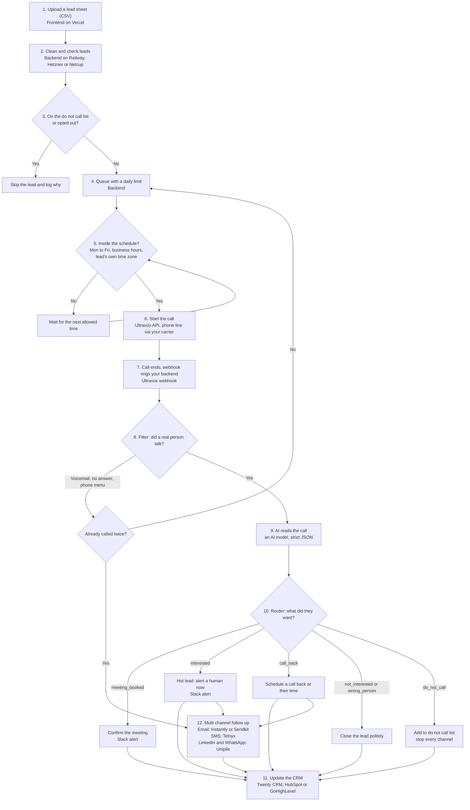

# The Step 8 System Map

This is the shape of the AI sales system we build today with Claude Code. It is the same list from my mornings when I did everything by hand (filter, listen, read, write it down), now written as real code with limits, schedules and a CRM built in.

Use it as your blueprint for [prompt 06](prompts/06-CLAUDE-CODE-BUILD-SPEC.md). Build it one box at a time and test each box before you add the next.

## The diagram

GitHub shows this diagram as a picture. In other viewers you will see the text version, and the table below says the same thing.

## The same system as a table

| # | Box | What happens | Real tool we use | The idea behind it (step 3) |
| --- | --- | --- | --- | --- |
| 1 | Upload a lead sheet | You upload a CSV of leads on a simple screen and start a campaign | Frontend on Vercel, built with Claude Code and shadcn/ui | HTTP request |
| 2 | Clean and check leads | Phone numbers put in one standard format, duplicates removed, rows with missing data set aside with a reason | Backend on Railway, Hetzner or Netcup | Filter |
| 3 | Do not call check | Anyone on your do not call list, or who opted out before, is skipped | Backend and its database | Filter |
| 4 | Daily limit | Only a set number of leads are reached per day, so the system never calls too many people | Backend queue | Rule |
| 5 | Schedule | Calls only go out Monday to Friday, in business hours, in the lead's own time zone | Backend scheduler | Filter |
| 6 | Start the call | The backend asks the voice tool to call the lead with your caller prompt | Ultravox API, with a phone line from a carrier it supports | HTTP request |
| 7 | Call ends | The voice tool tells your backend the call is over and sends the result | Ultravox webhook | Webhook |
| 8 | Filter | Voicemail, no answer and automatic phone menus are taken out and called again once (double dial). Calls where a real person talked move on | Backend | Filter and router |
| 9 | AI reads the call | AI reads the transcript and returns strict JSON: outcome, call back time, summary, next action, confidence | An AI model through its API (for example a Claude model), using [prompt 05](prompts/05-POST-CALL-ANALYSIS.md) | AI as one step |
| 10 | Branches | Each lead goes down the right path based on the outcome | Backend router | Router |
| 11 | Update the CRM | The lead, the call, the outcome and the next step are written to the CRM | Twenty CRM (ours); HubSpot or GoHighLevel for clients who use them | HTTP request |
| 12 | Multi channel follow up | Leads who need more get a short sequence on other channels, which stops the moment they reply, book or opt out | Email: Instantly or Sendkit. SMS: Telnyx. LinkedIn and WhatsApp: Unipile | Webhooks and HTTP requests |
| Always on | Alerts and logs | Booked meetings, hot leads and failures go to a team channel. Every step is logged | Slack, plus your backend logs | Webhook |

## What makes it a system and not a script

- **Limits:** a daily cap, a cap on calls at the same time, and a cap on attempts per lead.
- **Schedules:** days, hours and the lead's own time zone, plus public holidays if you can.
- **Safety:** a do not call list that every channel checks, every time, before every message or call.
- **Idempotency:** if a webhook arrives twice (it will), nothing happens twice. No double calls, no double CRM records.
- **Retries:** if an outside tool fails for a moment, the system tries again a few times, then alerts you instead of failing quietly.
- **Logs:** for every lead you can see what happened, when, and why.
- **One module per outside tool:** so you can switch a tool later (step 7) by changing one place.

## Where to start

Do not build all 12 boxes at once. A good order:

1. Boxes 7, 8 and 9: receive a webhook, filter, AI analysis. You already practised this in step 4.
2. Boxes 10 and 11: route the result and update the CRM.
3. Boxes 1 to 6: upload, limits, schedule, start calls.
4. Box 12: follow up, one channel at a time.
5. Then run [prompt 08](prompts/08-PRODUCTION-CHECKLIST-AND-TEST-PLAN.md) before any real lead is called.
